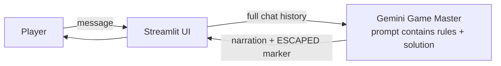
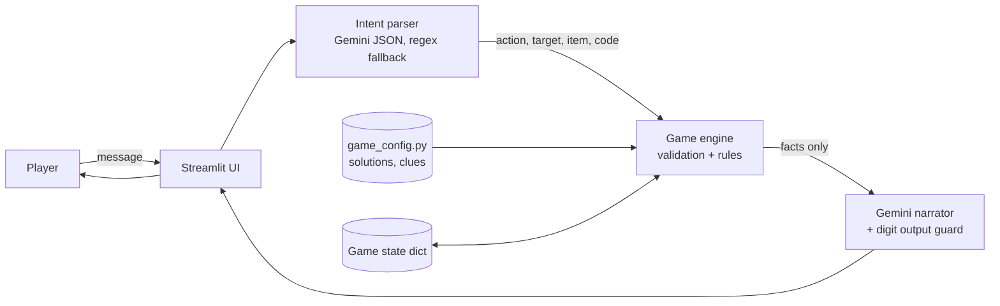

# 🔐 AI Escape Room (Gemini + Streamlit)

An interactive escape room where an LLM acts as Game Master. Built in two versions to show why a
prompt-only LLM game is fragile and how structured state + validation makes it reliable.

## Problem
A player wakes up in a locked library (desk, bookshelf, painting, locked drawer, keypad door) and must
find clues, solve puzzles and escape. LLMs are great storytellers but forget actions, invent objects,
leak solutions and can be talked into breaking the rules.

## Solution
| | Version 1 | Version 2 |
|---|---|---|
| Game logic | In the prompt | Python engine (`v2/engine.py`) |
| Memory | Chat history | Structured state dict |
| Solutions | In the LLM prompt | Only in `game_config.py`, never sent to the LLM |
| LLM role | Everything | Parse intent + narrate facts |
| Win check | LLM emits `[ESCAPED]` | Code checks codes and state |

**Puzzle chain:** search desk -> brass key; bookshelf numbers -> drawer code; drawer note -> "founding year";
painting plaque -> door code.

## Tech stack
Python 3.10+, Streamlit, Google Gemini API (free tier, `google-genai`), python-dotenv, pytest.

## Install & run
```bash
git clone https://github.com/<your-username>/AI-Escape-Room.git
cd AI-Escape-Room
python -m venv .venv && source .venv/bin/activate   # Windows: .venv\Scripts\activate
pip install -r requirements.txt
cp .env.example .env                                  # then paste your free key from https://aistudio.google.com/apikey
streamlit run v1/app.py      # Version 1
streamlit run v2/app.py      # Version 2 (also runs offline without a key)
pytest -q                    # engine tests, no API key needed
```

## Architecture
### Version 1

### Version 2


## V1 problems -> V2 changes
1. State only in chat history -> explicit state dict (inventory, drawer/door status, hints, turns).
2. LLM decides outcomes -> Python validates every action; LLM narrates the result.
3. Solutions in the prompt (leakable) -> solutions and undiscovered clues never reach the LLM.
4. Prompt injection / fake admin -> `cheat` intent is refused deterministically; unlocking needs the real code.
5. Codes parsed by LLM could be hallucinated -> code is extracted by regex from the raw message.
6. Narrator could invent numbers -> output guard rejects digits not in the facts; falls back to plain facts.

## Test cases
See [TEST_CASES.md](TEST_CASES.md). Automated V2 tests: `pytest -q` (11 tests).

## Screenshots / demo
Add images to `docs/screenshots/` and link them here.

## Limitations & future work
- Free-tier rate limits; V2 falls back to the rule-based parser/plain narration on API errors.
- Rule-based fallback parser handles limited phrasing.
- Single room; future: multiple rooms, timed hints, LLM-as-judge evaluation.

> Never commit `.env`. It is listed in `.gitignore`; use `.env.example` as the template.
